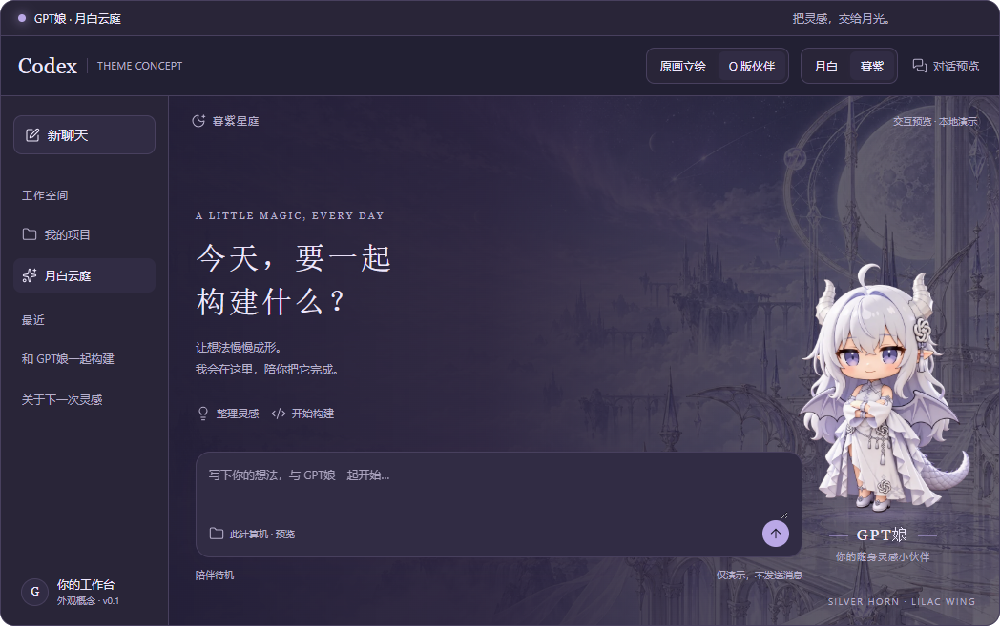

# GPT娘 · 月白云庭

**给 Codex Desktop 的银白淡紫主题与角色伙伴。** 支持原画 / Q版、月白 / 暮紫、独立预览、点击与拖动，以及可恢复的本机实时换肤。

> v0.1.2 是实验版，为 GitHub 插件市场安装补上 Windows 固定运行器、独立按需任务与桌面启动入口。预览与模拟页面交互已验证；真实 Codex 换肤需要首次启用本机调试接口，并可能随官方界面变化而需要适配。项目与 OpenAI 无隶属关系。

| 月白 · 原画 | 暮紫 · Q版 |
|---|---|
|  |  |

## 下载和安装

从 [Releases](https://github.com/SongMG110/gpt-moon-garden/releases) 下载 ZIP，解压后：

1. 仅看预览：双击 `preview/index.html`，不必连接 Codex。
2. Windows 双击 **`Setup.cmd`** 配置固定运行器与按需管理任务。需要 **Node.js 22+**；Codex 内执行时也可使用其自带 Node。
3. 正常退出 Codex 后，双击新建的 **GPT Moon Garden** 桌面快捷方式。它会启动客户端、等待工作区连接并自动尝试应用；已经运行且没有接口时会拒绝继续，不结束进程。

也可以从 GitHub 添加插件市场：

```sh
codex plugin marketplace add SongMG110/gpt-moon-garden
```

在桌面端插件目录中选择「GPT娘 · 月白云庭」来源并安装。初次添加来源可能需要自然重启桌面端；安装后可对 Codex 说 **“使用 moon-garden 打开主题管理器”**。这个技能插件负责管理本地皮肤运行器，并非官方全局换肤 API。发布到 GitHub 不代表已通过官方公共插件目录审核。

**从插件市场安装的用户请先看 [逐步配置指南](docs/SETUP.zh-CN.md)**：安装后选择插件并请求“为我的 Windows 配置月白云庭，运行 setup 并创建启动快捷方式”。固定运行器不依赖会被更新的插件缓存目录。

## 更新时会中断吗？

| 更新内容 | 行为 |
|---|---|
| 切换人物、配色、大小、浓度 | 直接应用，不重启 Codex |
| 更新 `assets/*.webp`、`renderer/skin.js` | 启用后每约 2.5 秒检查并重新应用，不刷新聊天页面 |
| 更新控制器代码 | 需要重启本地控制器；通常不用重启 Codex |
| 更新技能、插件清单、增加插件来源 | 由宿主管理，可能需要重新加载插件或自然重启 |
| 首次开启 CDP | 通常需要在结束当前任务后关闭并重新启动 Codex 一次 |

**控制器从不结束、重启、刷新 Codex，也不修改 WindowsApps、app.asar、登录和模型配置。** “不打断聊天”针对外观更新，不能承诺任何类型的应用或插件升级都无须重启。

## 功能

- 原画立绘 / Q版伙伴，月白云庭 / 暮紫星庭。
- 人物大小、背景浓度、显示与动效开关。
- 点击说话、拖动位置、简单整图动画；尊重系统减少动态效果设置。
- 在能识别“停止生成”控件时，展示工作/完成反馈；不读聊天正文。
- 本机管理页与独立预览；恢复按钮移除本项目注入的样式和 DOM。
- 插件清单、GitHub 插件市场、发行 ZIP；无 npm 运行时依赖、无遥测。

当前不包含完整逐帧动画、Live2D、骨骼绑定或系统级桌宠窗口。透明角色图由用户参考图生成，详见 [素材说明](ASSETS.md)。

## 开发

```sh
npm test
npm run build
npm start
npm run enable
npm run package
```

运行时数据放在 Windows `%LOCALAPPDATA%/GPTMoonGarden` 或其他系统的用户配置目录。可用 `MOON_GARDEN_DATA_DIR`、`MOON_GARDEN_PORT`、`MOON_GARDEN_CDP` 覆盖；CDP 地址必须是回环 HTTP 地址。

更多：[安装](docs/INSTALL.md) · [架构与适配](docs/ARCHITECTURE.md) · [验证范围](docs/VALIDATION.md) · [更新记录](CHANGELOG.md)。欢迎提交 Issue、修复适配和贡献原创主题或角色。

代码使用 [MIT](LICENSE)；素材的来源与使用范围独立记录于 [ASSETS.md](ASSETS.md)。
